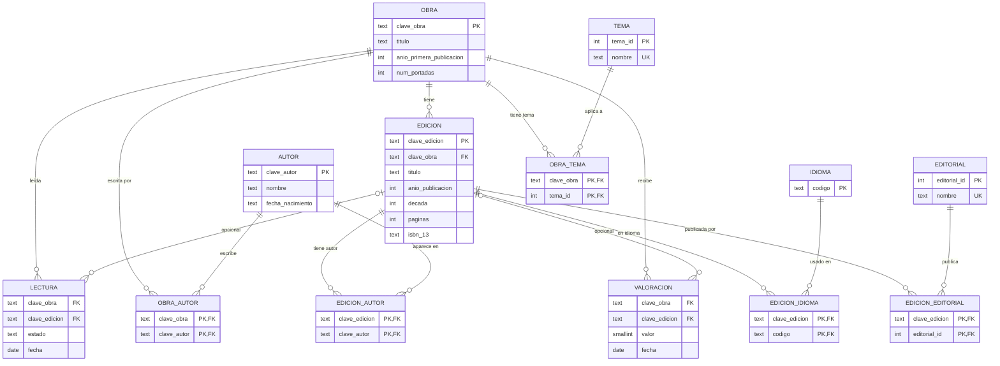

# Diagrama ER: modelo normalizado (esquema `openlibrary`)

GitHub renderiza este diagrama directamente. Las relaciones N:M pasan por tablas intermedias.

## Notas de diseño

- **Claves naturales**: `clave_obra`, `clave_edicion` y `clave_autor` son las claves de Open Library. Se conservan para poder volver al dato original.
- **Claves sustitutas**: `editorial_id` y `tema_id` son enteros porque los nombres pueden ser largos y tener variantes.
- **Sin clave primaria en `VALORACION` y `LECTURA`**: el dump no identifica al usuario, así que dos filas iguales pueden ser eventos distintos.
- **Relaciones opcionales** (`o|--o{`): una valoración o lectura puede no tener edición.
- **Una edición, una obra**: en el dump una edición puede apuntar a varias obras; el modelo guarda la primera. Ver `03_limpieza_spark/02_clean_a_curated.py`.
- **Esquema estrella**: ver `ddl_estrella.sql`. Las mismas valoraciones y lecturas, con dimensiones de obra y de fecha.
