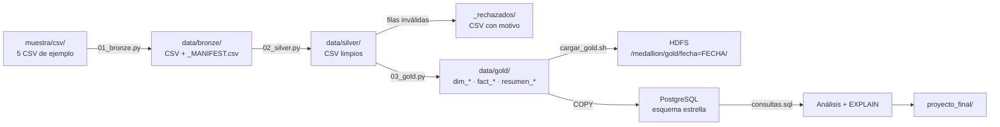

# Big Data con Open Library — medallion + HDFS + PostgreSQL

Proyecto para enseñar **arquitectura Medallion** con un ETL en PySpark local sobre CSV, y después publicar el resultado en HDFS, cargarlo en PostgreSQL y analizarlo con SQL.

- **Núcleo:** `muestra/csv/` → bronze → silver → gold, todo en CSV local.
- **Extensión:** gold → HDFS → PostgreSQL → consultas SQL → proyecto final.
- **Guía impresa:** [`manual/manual.pdf`](manual/manual.pdf) con el procedimiento manual completo.

## Ejecutar todo de forma manual

Hay dos archivos en la raíz:

```bash
# Solo el núcleo medallion (CSV local; no necesita HDFS ni PostgreSQL)
bash ejecutar_todo.sh

# Flujo completo: medallion + HDFS + PostgreSQL + SQL
bash ejecutar_todo_completo.sh
```

`ejecutar_todo_completo.sh` hace, en orden:

1. Detectar o instalar Java 17, Hadoop 3.5 y los binarios de PostgreSQL; crear el venv con `pyspark` + `psycopg` si falta.
2. Preparar HDFS y PostgreSQL: configuración base, rutas, rol/base y servicios; arrancar lo que haga falta.
3. `etl/01_bronze.py`, `etl/02_silver.py`, `etl/03_gold.py`.
4. `hdfs/cargar_gold.sh` → `/medallion/gold/fecha=FECHA/`.
5. `postgres/cargar_gold.py --reiniciar` → esquema `estrella`.
6. `"$PGBIN/psql" -v ON_ERROR_STOP=1 -d "$PGDATABASE" -f sql/verificar.sql` y el mismo con `sql/consultas.sql`.

Para ejecutar comandos a mano en otra terminal, primero carga el entorno: `source entorno.sh && ol_detectar_venv "pyspark, psycopg" && ol_detectar_pg`. Así `python3` usa el venv y `psql` está en `PATH`.

La fecha del snapshot se puede fijar:

```bash
OL_FECHA=2026-11-25 bash ejecutar_todo_completo.sh
```

## Flujo visual



Diagramas detallados en [`docs/flujo.md`](docs/flujo.md); explicación didáctica en [`docs/medallion.md`](docs/medallion.md).

## Estructura

```text
.
├── ejecutar_todo.sh             # núcleo medallion en CSV
├── ejecutar_todo_completo.sh    # flujo completo
├── entorno.sh                   # detección de Java, Hadoop, venv y PostgreSQL
├── requirements.txt             # pyspark + psycopg
├── muestra/csv/                 # CSV de ejemplo (entrada, versionados)
├── etl/
│   ├── common.py                # rutas, SparkSession, E/S de CSV
│   ├── 01_bronze.py             # copia íntegra + manifiesto SHA-256
│   ├── 02_silver.py             # validación, dedupe, rechazos
│   └── 03_gold.py               # modelo estrella + agregación
├── hdfs/
│   ├── cargar_gold.sh           # sube gold a /medallion/gold/fecha=FECHA/
│   └── reportar_hdfs.sh         # tamaño, bloques y replicación
├── postgres/
│   └── cargar_gold.py           # DDL + COPY desde data/gold
├── sql/
│   ├── ddl.sql                  # esquema estrella
│   ├── verificar.sql            # conteos e integridad
│   └── consultas.sql            # 6 consultas de ejemplo
├── proyecto_final/
│   ├── README.md                # casos y entregables
│   ├── rubrica.md               # 100 puntos
│   └── plantilla_informe.md     # informe máximo 6 páginas
├── manual/
│   ├── manual.md                # fuente del manual
│   ├── generar_pdf.sh           # envoltorio para regenerar el PDF
│   ├── generar_pdf.py           # maquetación del PDF con ReportLab
│   └── manual.pdf               # manual maquetado para ejecutar todo a mano
├── docs/
│   ├── flujo.md
│   └── medallion.md
└── data/                        # generado (no versionado)
    ├── bronze/
    ├── silver/
    └── gold/
```

## Las tres capas

| Capa | Regla | Resultado |
|---|---|---|
| **Bronze** | No se limpia nada; se conserva el origen y su hash | `data/bronze/*.csv` + `_MANIFEST.csv` |
| **Silver** | Se valida, se deduplica y se guardan los rechazos | `data/silver/*.csv` y `_rechazados/` |
| **Gold** | Se organiza para responder preguntas | `data/gold/dim_*`, `fact_*`, `resumen_*` |

Después, HDFS guarda el gold particionado por fecha y PostgreSQL lo carga con PK, FK y CHECK.

## Conteos esperados con la muestra

| CSV de entrada | Filas |
|---|---:|
| `authors.csv` | 381 |
| `works.csv` | 200 |
| `editions.csv` | 1.507 (3 se rechazan por título vacío) |
| `ratings.csv` | 47.443 |
| `reading-log.csv` | 1.160.547 |

| Tabla del gold / PostgreSQL | Filas |
|---|---:|
| `dim_obra` | 200 |
| `dim_fecha` | 3.287 |
| `fact_valoracion` | 47.443 |
| `fact_lectura` | 1.160.547 |
| `resumen_valoraciones_anio` | 9 |

## Requisitos

- Java 17: se instala Amazon Corretto 17 si no existe.
- Hadoop 3.5 (para el cliente HDFS; las rutas del ETL son `file://`): se descarga y configura solo.
- Python 3.11+; el orquestador crea el venv e instala `requirements.txt` si hace falta.
- PostgreSQL accesible por `PGHOST`/`PGPORT`/`PGUSER`/`PGDATABASE`; si no hay binarios se instalan con `pgserver`, y si no hay `PGDATA` se inicializa solo.
- `reportlab` (incluido en `requirements.txt`) solo para regenerar el PDF con `bash manual/generar_pdf.sh`.
- pgAdmin 4 `9.18` opcional para explorar PostgreSQL en `http://127.0.0.1:5050/`; instalación paso a paso en el manual, sección 3.1.

Rutas personalizadas:

```bash
OL_TOOLS_DIR=/ruta/herramientas \
OL_JAVA_HOME=/ruta/jdk OL_JAVA_URL=https://.../jdk.tar.gz \
OL_HADOOP_HOME=/ruta/hadoop OL_HADOOP_URL=https://.../hadoop.tar.gz \
OL_VENV=/ruta/venv OL_PGVENV=/ruta/venv-pgtest \
OL_PGBIN=/ruta/pg/bin OL_PGDATA=/ruta/pgdata \
OL_PGADMIN=postgres OL_HDFS_DATA_DIR=/ruta/hdfs \
bash ejecutar_todo_completo.sh
```

También puedes ejecutar cada fase por separado; el orden está en el [manual PDF](manual/manual.pdf).

## Proyecto final

En [`proyecto_final/`](proyecto_final/) están los tres casos de estudio, la rúbrica de 100 puntos y la plantilla de informe. La entrega mínima incluye una validación propia en el ETL, el gold publicado en HDFS, la carga verificada en PostgreSQL, cinco consultas y `EXPLAIN ANALYZE` antes y después de índices.

> Los avisos de PySpark sobre pandas, librerías nativas de Hadoop y ventanas sin partición son informativos; el pipeline termina correctamente.
