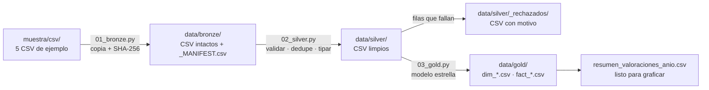

# Big Data con Open Library — versión simplificada

Proyecto reducido para enseñar **arquitectura Medallion** con un ETL en PySpark local.

**Solo CSV.** No hay HDFS, PostgreSQL, Parquet ni dumps comprimidos. Los datos de ejemplo ya están en `muestra/csv/`.

## ▶️ Ejecutar todo de forma manual

El archivo que necesitas está en la raíz del repo:

```bash
bash ejecutar_todo.sh
```

Ese script detecta Java, Hadoop y el venv con PySpark, y ejecuta en orden:

1. `etl/01_bronze.py`
2. `etl/02_silver.py`
3. `etl/03_gold.py`

Al terminar imprime todos los CSV generados en `data/`.

## 🧠 Flujo visual



Si quieres el diagrama de ejecución de scripts y la explicación para alumnos:

- [`docs/flujo.md`](docs/flujo.md) — flujo de archivos y de scripts.
- [`docs/medallion.md`](docs/medallion.md) — qué se hace en cada capa y por qué.

## 📁 Estructura

```text
.
├── ejecutar_todo.sh          # ← ejecuta TODO (archivo manual)
├── requirements.txt
├── muestra/csv/              # CSV de ejemplo (entrada, versionados)
├── etl/
│   ├── common.py             # rutas, SparkSession, lectura/escritura CSV
│   ├── 01_bronze.py          # copia íntegra + manifiesto con hash
│   ├── 02_silver.py          # limpieza, validación, dedupe y rechazos
│   └── 03_gold.py            # modelo estrella + agregación
├── docs/
│   ├── flujo.md
│   └── medallion.md
└── data/                     # generado por el ETL (no versionado)
    ├── bronze/
    ├── silver/
    └── gold/
```

## 🥉🥈🥇 Las tres capas

| Capa | Regla | Resultado |
|---|---|---|
| **Bronze** | No se limpia nada; se conserva el origen y su hash | `data/bronze/*.csv` + `_MANIFEST.csv` |
| **Silver** | Se valida, se deduplica y se guardan los rechazos | `data/silver/*.csv` y `_rechazados/` |
| **Gold** | Se organiza para responder preguntas | `data/gold/dim_*`, `fact_*`, `resumen_*` |

La explicación detallada está en [`docs/medallion.md`](docs/medallion.md).

## 📊 Datos y conteos esperados

Entrada (`muestra/csv/`):

| CSV | Filas |
|---|---:|
| `authors.csv` | 381 |
| `works.csv` | 200 |
| `editions.csv` | 1.507 (3 se rechazan por título vacío) |
| `ratings.csv` | 47.443 |
| `reading-log.csv` | 1.160.547 |

Salida del gold (`data/gold/`):

| CSV | Filas |
|---|---:|
| `dim_obra.csv` | 200 |
| `dim_fecha.csv` | 3.287 |
| `fact_valoracion.csv` | 47.443 |
| `fact_lectura.csv` | 1.160.547 |
| `resumen_valoraciones_anio.csv` | 9 |

## 🔧 Requisitos

- Java 17
- Python 3.11 o superior
- PySpark 4.3.0 (`pip install -r requirements.txt`)

`ejecutar_todo.sh` busca Java y Hadoop en las rutas habituales y usa cualquier venv que tenga PySpark. Si el tuyo está en otra ruta:

```bash
OL_JAVA_HOME=/ruta/jdk OL_HADOOP_HOME=/ruta/hadoop OL_VENV=/ruta/venv bash ejecutar_todo.sh
```

También puedes ejecutar los pasos por separado, siempre en este orden:

```bash
python3 etl/01_bronze.py
python3 etl/02_silver.py
python3 etl/03_gold.py
```

> Los avisos de PySpark sobre pandas, librerías nativas de Hadoop y ventanas sin partición son informativos; el pipeline termina correctamente.

## 🧹 Qué cambió respecto al curso original

Se eliminaron las partes que no eran necesarias para este objetivo: HDFS, PostgreSQL, DDL/SQL, consultas, ejercicios, proyecto final, dumps comprimidos y caché de API. El historial de Git conserva todo eso si se necesita recuperarlo.

Lo que queda es un pipeline corto, reproducible y explicado: **CSV → bronze → silver → gold**.
