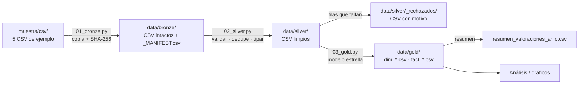
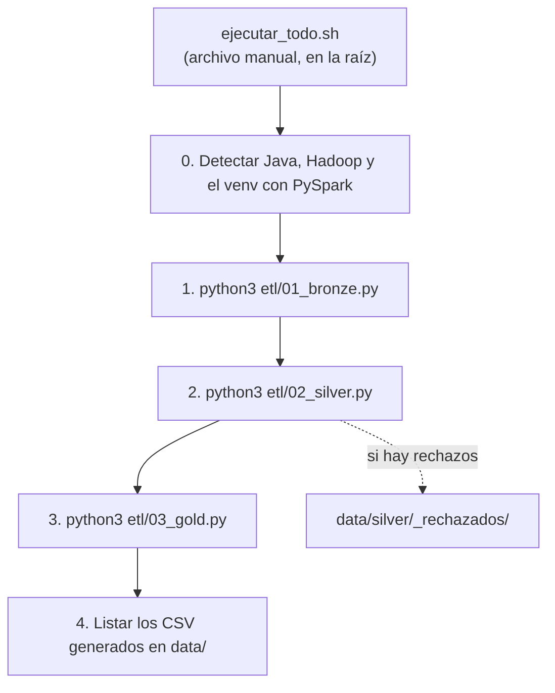
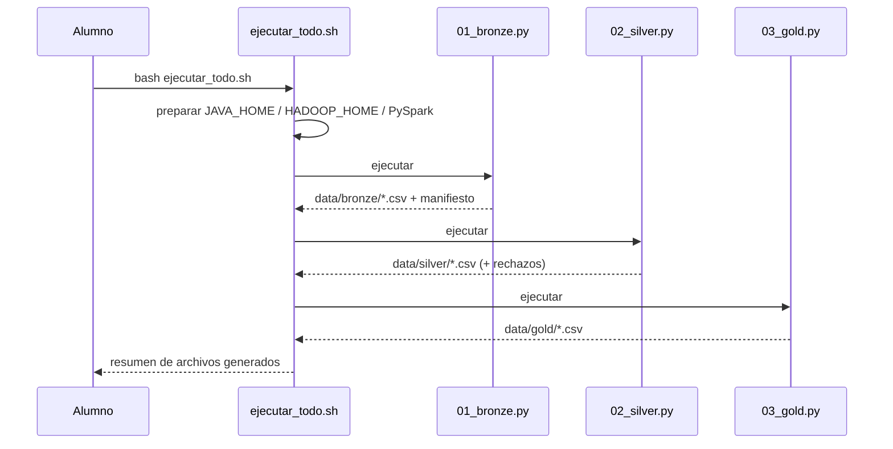

# Flujo de ejecución y de datos

Hay dos formas de leer este diagrams: **qué archivos se producen** y **en qué orden se ejecutan los scripts**.

## 1. Flujo de datos (archivos)



La regla importante: **cada flecha es un archivo real en disco**. No hay HDFS, no hay base de datos y no hay Parquet. Puedes abrir cualquier CSV con un editor o con `head`.

## 2. Flujo de ejecución (scripts)



`ejecutar_todo.sh` es el **único archivo que necesitas ejecutar a mano**. Los tres scripts de `etl/` también se pueden ejecutar por separado, pero, en ese caso, debes respetar el orden bronze → silver → gold.

## 3. Secuencia desde el punto de vista del alumno



## 4. Qué mirar después de ejecutar

```bash
# Ver los CSV finales
ls -lh data/bronze data/silver data/gold

# Ver por qué se rechazaron filas
head data/silver/_rechazados/*.csv

# Ver la tabla analítica final
head data/gold/resumen_valoraciones_anio.csv
```

Si quieres entender el significado de cada capa, lee [medallion.md](medallion.md).
