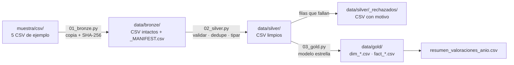
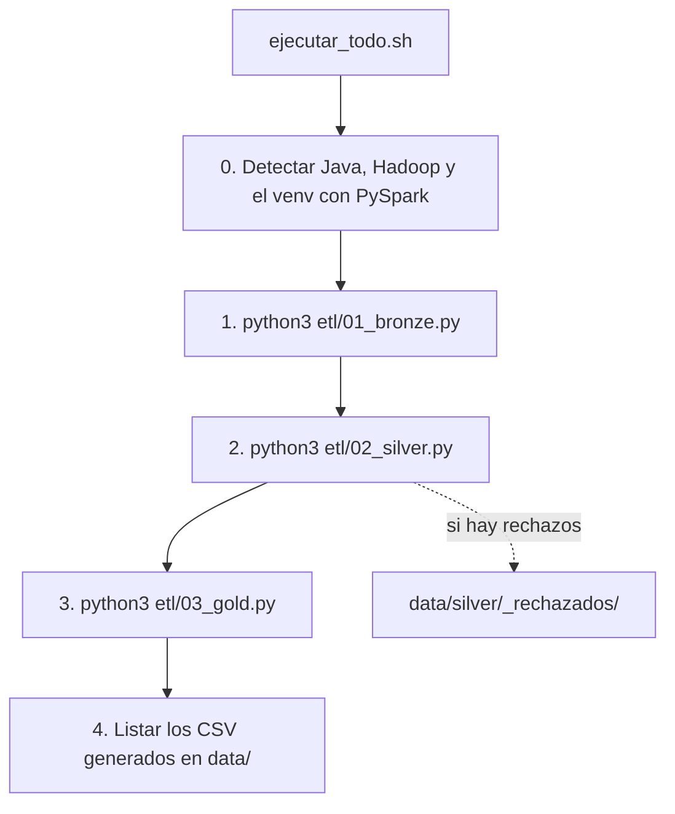
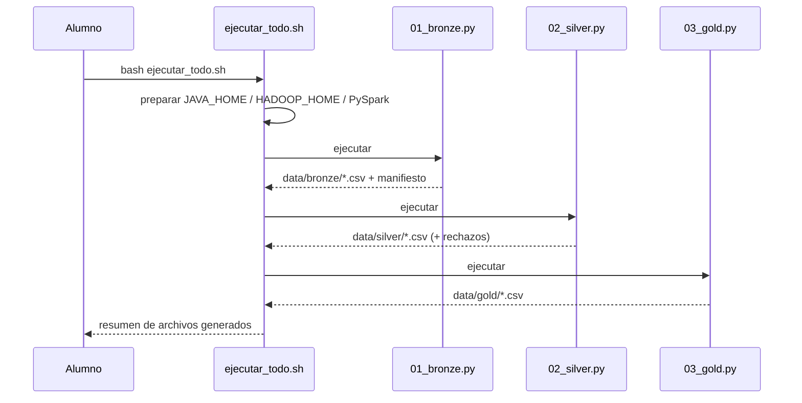
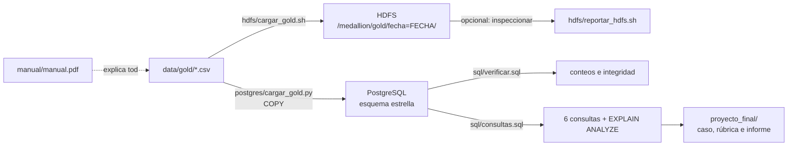
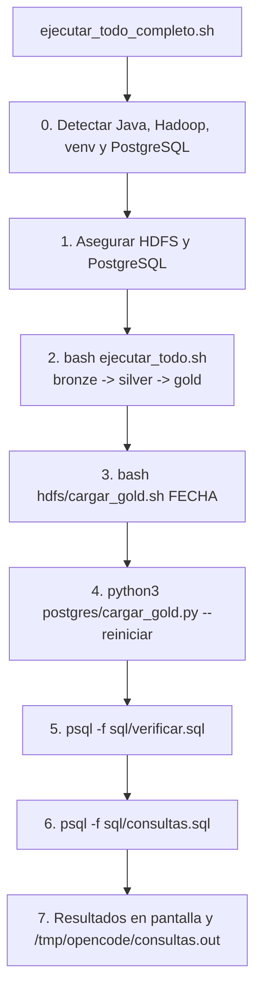

# Flujo de ejecución y de datos

Hay dos niveles bien separados:

1. **Núcleo medallion:** CSV local → bronze → silver → gold.
2. **Extensión:** gold → HDFS → PostgreSQL → consultas SQL → proyecto final.

Puedes ejecutar solo el núcleo o el flujo completo. En ambos casos todo se hace a mano desde la raíz del repo.

## 1. Flujo de datos del núcleo (archivos)



En el núcleo, cada flecha es un archivo real en disco. No hay HDFS ni base de datos: puedes abrir cualquier CSV con `head` o con un editor.

## 2. Flujo de ejecución del núcleo (scripts)



`ejecutar_todo.sh` es el script del núcleo. Los tres scripts de `etl/` también se pueden ejecutar por separado, siempre en orden bronze → silver → gold.

## 3. Secuencia desde el punto de vista del alumno



## 4. Flujo completo (extensión)



HDFS y PostgreSQL son dos destinos independientes del mismo gold: uno publica los CSV en un lago con partición por fecha; el otro los carga en tablas con restricciones.

## 5. Flujo de ejecución completo



## 6. Qué mirar después de ejecutar

```bash
# CSV finales y rechazos
ls -lh data/bronze data/silver data/gold
head data/silver/_rechazados/*.csv
head data/gold/resumen_valoraciones_anio.csv

# HDFS
bash hdfs/reportar_hdfs.sh

# PostgreSQL
psql -v ON_ERROR_STOP=1 -f sql/verificar.sql
psql -v ON_ERROR_STOP=1 -f sql/consultas.sql
```

Para la explicación paso a paso, consulta el [manual PDF](../manual/manual.pdf). Para la teoría de las capas, lee [medallion.md](medallion.md).
